<p align="center">
  
</p>

<h1 align="center">ViSUBLY</h1>

<p align="center">
  <b>Grab · Sub · Watch</b><br>
  A Windows video studio: grab videos from Chrome the way IDM does, play them with subtitles, and watch them on your iPhone over Wi‑Fi.
</p>

<p align="center">
  
  
  
  
</p>

<p align="center">
  <a href="https://github.com/ndd2505/ViSUBLY/releases/latest"><b>Download for Windows</b></a>
  &nbsp;·&nbsp; or clone the repo and double-click <code>Install-ViSUBLY.cmd</code>
</p>

<p align="center">
  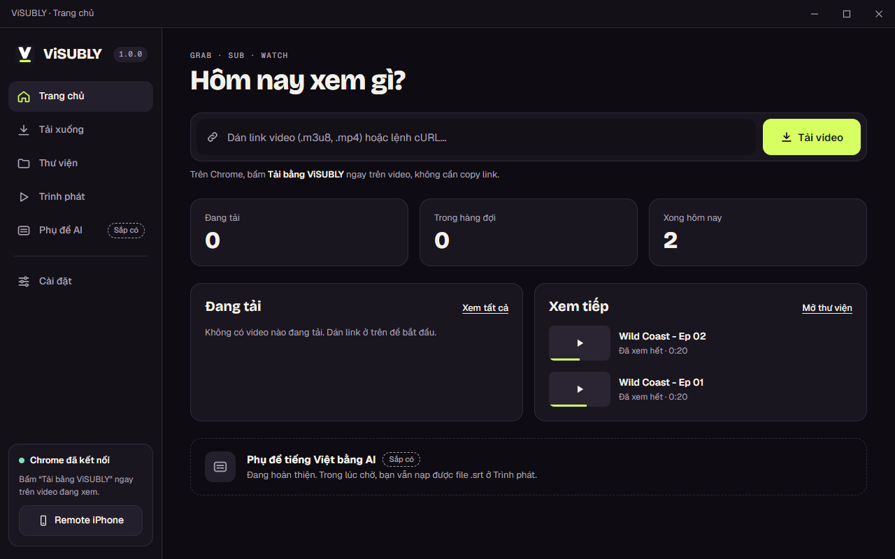
</p>

> The app UI is in Vietnamese. The labels quoted below are the Vietnamese ones you'll see on screen, with English translations.

## Highlights

- **One-click capture from Chrome.** No DevTools or "Copy as cURL" needed. The extension finds the video on the page, lists its qualities with estimated sizes, and sends it to the app.
- **Download manager.** Paste a URL or a cURL command, run up to 3 downloads at once, see speed and ETA, and get readable error messages. The downloader and ffmpeg are bundled, so you don't need to install Python.
- **Sharper playback on RTX GPUs.** NVIDIA RTX Video Super Resolution upscales low-resolution video live while it plays. Nothing is processed in advance and no new file is created. If the GPU doesn't support it, the video plays at its original quality, and you can turn it off in Settings.
- **Upscale low-res videos into new files.** The **Nâng cấp video** (Upscale video) tab turns a 360p / 480p video into a 720p–4K copy with RTX Video Super Resolution or GPU filters. It picks the best setup for your PC automatically, shows live GPU / CPU / disk stats, and lets you test a short clip with a before/after slider first.
- **Player built for subtitles.** SRT and VTT files (UTF‑8, UTF‑16 and Windows‑1258) load automatically, and the folder becomes a playlist. Theater and fullscreen modes have an auto-hiding control bar, and there are keyboard shortcuts.
- **Open with ViSUBLY.** Set it as the default app for `.mp4 .m4v .mkv .webm .mov` and double-click a file to play it.
- **Drag and drop.** Drop folders onto the window to browse them in **Thư viện** (Library); several folders are merged into one library. Drop a video to play it, or a subtitle file to load it.
- **Watch on iPhone.** Pair once by scanning a QR code or tapping **Cho phép** ("Allow") on the PC. After that the phone reconnects on its own.
- **Dark and light themes.** Dark is the default. You can choose **Tối** (Dark), **Sáng** (Light) or **Theo Windows** (follow Windows).

---

## Features

### Grab videos from Chrome

<table>
  <tr>
    <td width="62%">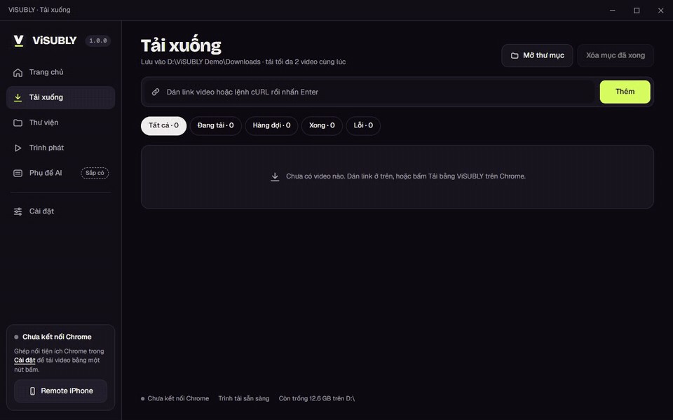</td>
    <td width="38%">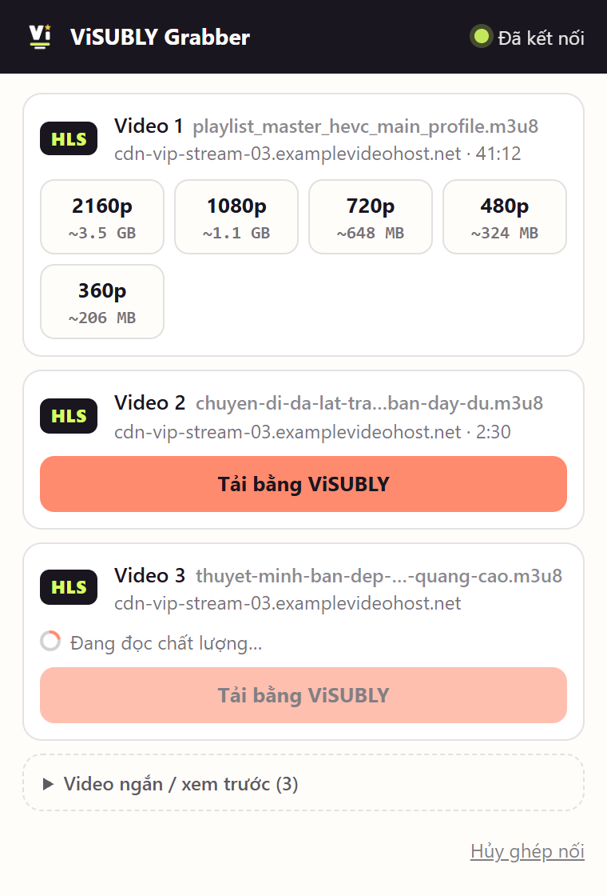</td>
  </tr>
</table>

- Detects **HLS (`.m3u8`)**, **DASH (`.mpd`)** and **MP4** streams while you browse.
- **One card per video.** Master and variant playlists are merged, and each card offers quality chips (`1080p ~1.1 GB`, `720p ~648 MB`, …).
- **Hides previews.** Autoplaying thumbnails and short ads are folded into a collapsed section. The threshold is set in **Cài đặt** (Settings): Off / 30 s / 1 min / 2 min / 5 min.
- Marks the video that is **playing now** (▶ Đang phát / ⏸ Đang dừng). Reloading the page clears the list, and videos from the previous page move to **Đã thấy trước đó** (Seen earlier).
- **Finds hidden playlists**: ones fetched by a service worker, renamed ones (`.txt`, `.png`…), and players inside iframes. If a site misbehaves, turn off **Dò video ẩn** (Hidden video detection) at the bottom of the popup.
- **"Không thấy video? Chẩn đoán"** (No video? Diagnose) explains why a page shows nothing (DRM, players that stream over WebSocket/P2P, unknown formats) and copies a short report without cookies or full links.
- A floating **"Tải bằng ViSUBLY"** ("Download with ViSUBLY") button appears on the video you are watching.
- The extension sends the page's Referer, Origin, User‑Agent and Cookie along with the link, so protected CDNs keep working.
- The app's **"Tải video này?"** ("Download this video?") dialog opens with the quality preselected. You can rename the file, pick a folder, then choose **Tải ngay** (Download now) or **Thêm vào hàng đợi** (Add to queue).
- **Safe by design.** The bridge listens on `127.0.0.1` only. The extension pairs with a 6‑digit code, tokens are stored hashed, and requests from ordinary web pages are rejected.

### Download manager

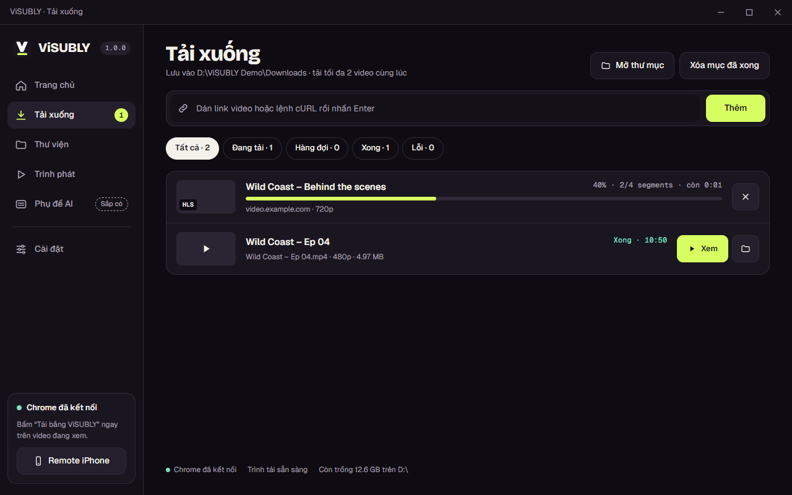

- Accepts a pasted URL, a full cURL command, or a link sent by the extension.
- Runs **1–3 downloads in parallel**. Each row shows progress, speed and ETA, with filters for downloading, queued, done and failed items.
- **Fast, IDM-style downloading.** Each video uses several connections at once: HLS segments (TS, fMP4, AES-128) are fetched in parallel and joined locally, and large MP4 files are split into byte ranges. On a test server capped at 2 MB/s per connection, AES-128 HLS downloaded 5× faster and a 148 MB MP4 7× faster than in 1.2.1. When a site limits connections (HTTP 429/403), ViSUBLY backs off automatically. **Số kết nối mỗi video** (Connections per video) in Settings: Tự động / Ít / Nhiều (Auto / Few / Many).
- Failures get a readable reason and a fix, for example: *"Link expired, reopen the page in Chrome and grab it again"*. The raw log is one click away.
- Windows notification when a download finishes. Finished items stay in the list until you clear them.
- The bundled engine and ffmpeg handle everything, and HLS output is muxed to MP4.

### Player

<table>
  <tr>
    <td width="55%">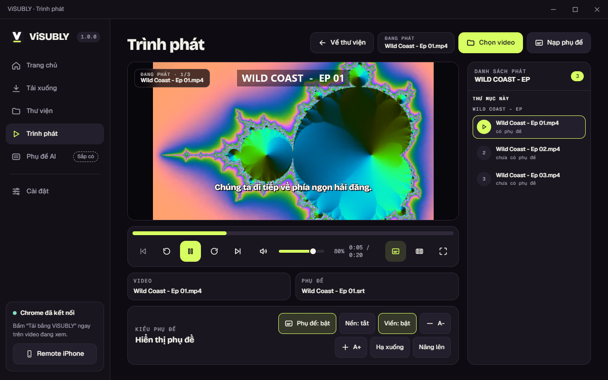</td>
    <td width="45%">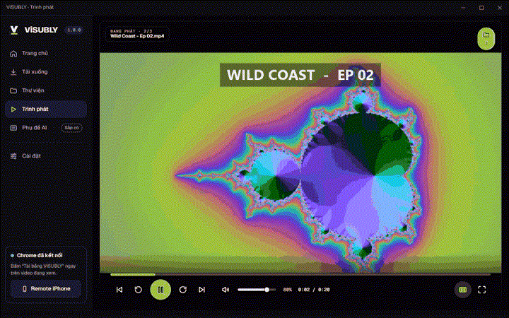</td>
  </tr>
</table>

- Subtitles with the same name as the video (`.srt` / `.vtt`) load automatically. Encodings are detected: UTF‑8, UTF‑16 and Windows‑1258 (common for Vietnamese).
- Subtitle styling: background, outline, size and position.
- **Folder playlist** with previous and next buttons and auto-advance to the next episode.
- **Theater and fullscreen** modes put the video on black, never cropped. The overlay control bar auto-hides after 2.5 s, and subtitles move up while it is visible.
- Formats the built-in player can't decode (AVI, HEVC…) show a clear message with an **Open with…** button.
- **Live video enhancement** (setting **Nâng chất lượng video**, on by default):
  - **NVIDIA RTX 20-series or newer** uses RTX Video Super Resolution. Turn on *RTX Video Enhancement → Super Resolution* in the NVIDIA App.
  - **Intel Arc / Iris Xe** uses Intel Video Super Resolution (experimental).
  - It kicks in whenever the video is shown larger than its resolution: a big window, theater mode or fullscreen. The player then shows a **"Nâng nét RTX"** ("RTX sharpening") badge.
  - Before enabling, ViSUBLY checks the GPU and its driver. On any other hardware, the video plays at its original quality.
  - Turning it off takes effect immediately.
  - If it causes trouble, it switches itself off and tells you why. That covers a crash at startup, a GPU process crash, or sustained dropped frames.

| Key | Action |
|---|---|
| `Space` | Play / pause |
| `←` / `→` | Seek −5 s / +5 s |
| `↑` / `↓` | Volume |
| `M` | Mute |
| `F` or double-click | Fullscreen |
| `T` | Theater mode |
| `Shift` + `N` / `P` | Next / previous video in the folder |
| `Esc` | Leave fullscreen, then theater |

### Upscale videos (Nâng cấp video)

One video at a time. The original file is never touched: the new copy is saved next to it as `name_1080p.mp4`, with the audio and any matching subtitle files (`name.srt`, `name.vi.srt`, …).

- **Levels** (**Mức nâng cấp**): **Tự động** (Automatic, default), **Nhanh** (Fast), **Cân bằng** (Balanced), **Đẹp nhất** (Best). Each shows whether it suits this PC: **Phù hợp với máy** (fits), **Nặng** (heavy: it runs, but the PC gets hot) or **Quá sức máy** (too much for this PC; you are warned before starting).
- **Automatic** checks the GPU once and runs a 3-second benchmark. The check covers whether RTX Video is really on, which hardware encoder works, and Vulkan. It then picks the best level **and** output resolution that stays comfortable for this PC. On an RTX 3060 with a 480p video, that is denoise → RTX Video → sharpen at 1080p, about 2× real time. **Đẹp nhất** adds a stronger NLMeans denoise on the CPU: better on noisy videos, about real-time speed.
- **Technologies:**

  | Technology | Runs on | Notes |
  |---|---|---|
  | RTX Video Super Resolution | NVIDIA GeForce RTX 20 or newer | Same driver feature as the player. The quality level comes from the NVIDIA App. |
  | Intel AI Super Resolution | Intel Arc / Iris Xe | Experimental. |
  | AMD FSR video upscaling | AMD Radeon | Experimental. |
  | FFmpeg filters | Any PC | Denoise, libplacebo upscaling (Vulkan), CAS sharpening. Also the automatic fallback. |
  | ONNX AI, Real-CUGAN, RIFE (60 fps), AI deblocking | — | Shown as **Có ở bản cập nhật sau** (coming in 1.3.0). |

  Anything your PC can't run is greyed out; click it to see why.
- **Thử & so sánh** (Test & compare): runs only when you click it. It processes a 5, 10 or 20-second clip with up to three setups. Then it shows a before/after slider, three still frames, the measured speed, and the estimated time and file size for the whole video.
- **Live device panel:** GPU load, graphics memory, temperature and power (NVIDIA), CPU, RAM, battery, and the free space on each drive.
- **Safety:**
  - It pauses by itself if the GPU passes 85 °C, and resumes below 75 °C.
  - It pauses if the output drive drops under 5 GB free.
  - If the GPU path fails, it restarts with FFmpeg filters and tells you why.
  - Windows doesn't go to sleep while a video is being upscaled, and the taskbar shows the progress.
- **Closing the app** while a video is being upscaled asks first: **Tiếp tục nâng cấp** (keep going) or **Dừng và thoát** (stop and quit; the partial file is deleted).

### Drag and drop

Drop items anywhere in the window:

- **Folders** open in **Thư viện** (Library), and subfolders are scanned too. Dropping several folders merges them into one library, grouped by folder.
- **Videos** play right away, with the rest of their folder as the playlist.
- **`.srt` or `.vtt` files** load onto the video that is playing.

### Open videos straight from Windows

The installer registers ViSUBLY for **`.mp4 .m4v .mkv .webm .mov`**. Right-click a file, choose **Open with → Visubly Studio**, and tick **Always** to make it the default app.

- If the app is closed, it opens straight into the player and starts playing.
- If it is already open, it switches to the new file without opening a second window.
- The other videos in that folder become the playlist.
- Selecting several files opens them as one playlist.
- Opening an `.srt` or `.vtt` file loads it onto the video that is currently playing.

### Watch on your iPhone

<table>
  <tr>
    <th>1 · Open the page on the iPhone</th>
    <th>2 · Allow it on the PC</th>
    <th>3 · Watch</th>
  </tr>
  <tr>
    <td>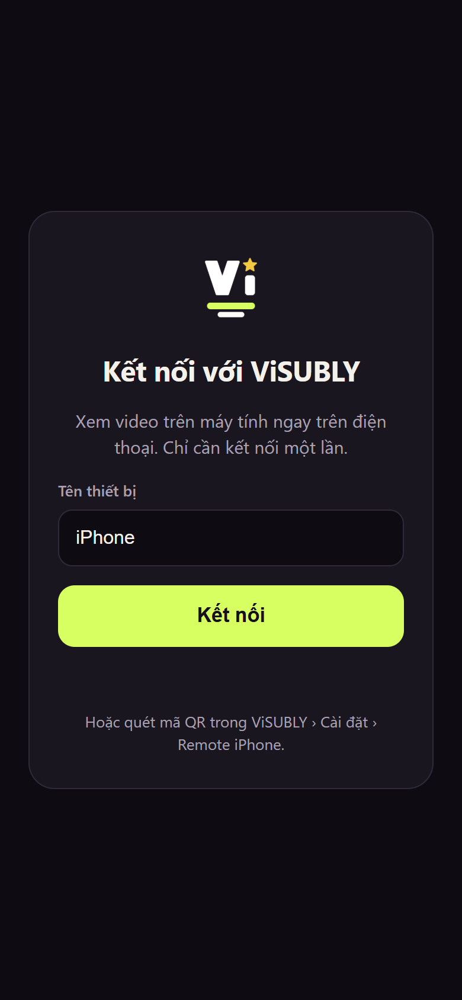</td>
    <td>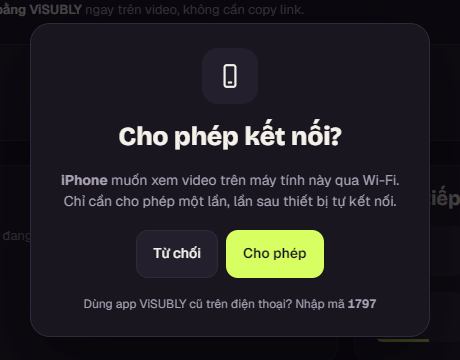</td>
    <td>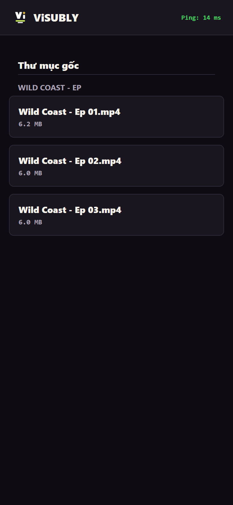</td>
  </tr>
</table>

- **Pair once.** Either scan the QR code in **Cài đặt → Remote iPhone**, or open `http://<your-pc>:3588`, tap **Kết nối** (Connect) and click **Cho phép** (Allow) on the PC.
- **Remembered devices.** Each phone gets its own long-lived token. It is stored hashed on the PC and survives app restarts. Add the page to your Home Screen and it reconnects on its own.
- **Auto-start.** Once a phone is paired, the Remote server starts with the app, so you don't have to turn it on by hand.
- **Device management.** See every paired phone with its last-seen time, and remove one or all of them from Settings.
- Streams over your local Wi‑Fi only. MP4 files play directly, and other formats are converted to HLS on the fly. The PC is kept awake while a phone is streaming.

> A Home Screen web app on iOS has its own storage. The first time you launch it from the Home Screen, tap **Kết nối** once more.

### Dark and light themes

<table>
  <tr>
    <td width="50%">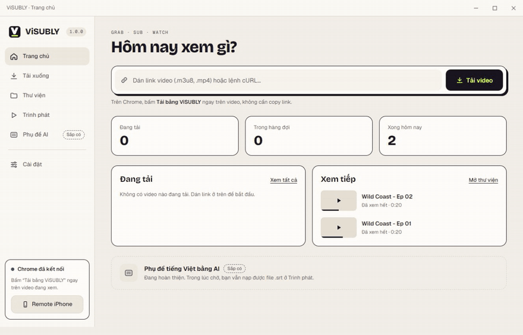</td>
    <td width="50%">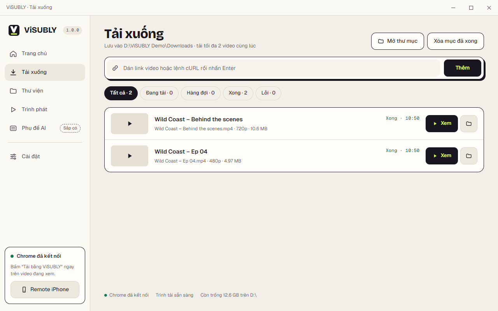</td>
  </tr>
</table>

### Settings

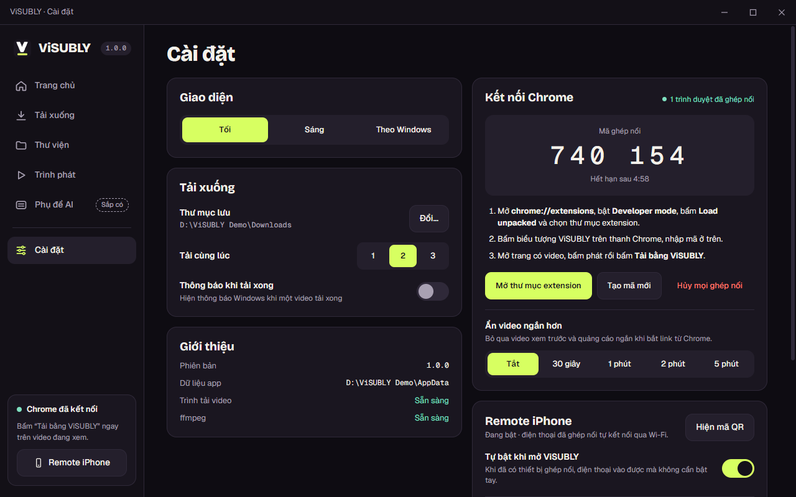

---

## Coming soon

These parts are visible in the app as **Sắp có** ("Coming soon") or are planned next:

- **AI Vietnamese subtitles.** Transcribe with Whisper, then translate and review with Claude or ChatGPT, right inside the app. Until then, you can load your own `.srt` / `.vtt` files.
- **Pause and resume downloads.** Today a stopped download restarts from the beginning.
- **macOS build and a native iPhone app.** The web remote works today.
- **Chrome Web Store release** of the extension, which currently installs with *Load unpacked*.
- **Code signing and auto-update**, which will remove the SmartScreen warning.
- **Exact duration and size for MP4 links.** ffprobe is now bundled; the downloader still has to use it.
- **More upscaling technologies (1.3.0):** ONNX Runtime AI (any DirectX 12 GPU), RIFE 60 fps, and vs-mlrt + TensorRT (DPIR deblocking, Real-CUGAN). They will download on demand.
- **Upscale several videos in a queue, plus advanced upscaling settings.**

## Limitations

- **DRM-protected streams** (Netflix, Disney+ and similar) are not supported, and won't be.
- Some sites only expose `blob:` URLs and can't be captured. Links that are signed or expire quickly may need to be grabbed again.
- The built-in player uses Chromium codecs. AVI, WMV and HEVC files, and AC3 audio, may need another player through **Open with…**.
- **Upscaling on Intel and AMD GPUs** has not been tested on real hardware yet, so it is marked experimental. If it fails, ViSUBLY falls back to FFmpeg filters.
- **Windows only** for now. The installer is not code-signed yet, so Windows may show *"Windows protected your PC"*: click **More info → Run anyway**.

---

## Install

1. **Get the installer.** Use one of these:
   - Download **`ViSUBLY-Setup-x.y.z.exe`** from the [latest release](https://github.com/ndd2505/ViSUBLY/releases/latest) and run it.
   - In a clone of this repo, **double-click `Install-ViSUBLY.cmd`**. It downloads the latest installer, checks its SHA256 checksum and runs it.

   Choose a folder and the installer creates Desktop and Start Menu shortcuts. If you'd rather not install, use `ViSUBLY-Portable-x.y.z.exe`.
2. **Install the Chrome extension.**
   1. In ViSUBLY, open **Cài đặt → Kết nối Chrome → Mở thư mục extension** (Settings → Connect Chrome → Open extension folder).
   2. In Chrome, open `chrome://extensions`, enable **Developer mode**, click **Load unpacked**, and select that folder.
   3. Click the ViSUBLY icon in Chrome's toolbar and enter the 6-digit code shown in the app.
3. **Optional: make ViSUBLY your default player.** Right-click a video → **Open with** → **Visubly Studio** → **Always**.
4. **Optional: connect your iPhone.** Open **Cài đặt → Remote iPhone** and scan the QR code. The phone and the PC must be on the same Wi‑Fi.

App data lives in `%APPDATA%\Visubly Studio` (settings, download queue, paired devices). Videos are saved to the folder you choose in Settings.

## Build from source

Requirements: Windows 10/11, **Node.js 20+**, **Python 3.10+** (to build the bundled downloader) and the **.NET 10 SDK** (to build `visubly-upscaler.exe`).

```powershell
npm install
npm run start           # run in development
npm run check           # quick app checks
npm run build:vendor    # FFmpeg 8.1 into vendor\ffmpeg + visubly-upscaler.exe into vendor\upscaler (npm run start needs them too)
npm run package:win     # downloader exe (PyInstaller) + vendor tools + NSIS installer + portable build in dist\
```

**Releases** are built by GitHub Actions ([`.github/workflows/release.yml`](.github/workflows/release.yml)). Pushing a tag such as `v1.0.2` runs the tests, builds the installer and portable app, and publishes them with `SHA256SUMS.txt` to GitHub Releases:

```powershell
git tag v1.0.2
git push origin v1.0.2
```

Tests:

```powershell
node scripts/test-capture-bridge.js       # Chrome ↔ app bridge (pairing, auth, probe)
node scripts/test-extension-streams.mjs   # extension stream grouping
node scripts/test-remote-pairing.js       # iPhone Remote pairing, trusted devices, WebSocket auth
node scripts/test-video-enhance.js        # GPU detection + crash guard for live video enhancement
node scripts/test-upscale-presets.js      # upscale tab: capabilities, auto choice, plans, estimates
```

## Project structure

```
src/main/             Electron main: window, settings, download queue, IPC, capture bridge, iPhone Remote server
src/renderer/         UI (vanilla JS + CSS tokens for dark/light)
engine/downloader/    Python HLS/MP4/DASH downloader (bundled as visubly-downloader.exe)
browser-extension/    Chrome MV3 extension "ViSUBLY Grabber"
build/                Icons and installer artwork
scripts/              Build helpers and tests
docs/                 Handoff notes (docs/HANDOFF.md) and README media
```

Developer notes on architecture, IPC and the bridge APIs, and the backlog are in [`docs/HANDOFF.md`](docs/HANDOFF.md).

## Bundled third-party software

- **FFmpeg 8.1** (GPL v3 build from [BtbN/FFmpeg-Builds](https://github.com/BtbN/FFmpeg-Builds), fetched by `scripts/fetch-ffmpeg.ps1`; source at [ffmpeg.org](https://ffmpeg.org/download.html)). Its license ships as `resources/ffmpeg/FFMPEG-LICENSE.txt`.
- **Vortice.Windows** (MIT) and the **.NET runtime** (MIT), inside `visubly-upscaler.exe`.

## Responsible use

ViSUBLY is a personal tool. Only download content you own or have permission to save, and respect each site's terms of service.

---

<sub>© 2026 Visubly · Personal project, all rights reserved.</sub>
